# FCT-Tarea-2

## Copia de los correos que has enviado a los profesores (petición de nombres DNS y de certificado), los nombres DNS pedidos con la justificación de cada uno (interno/externo) y la comprobación con dig de que resuelven.

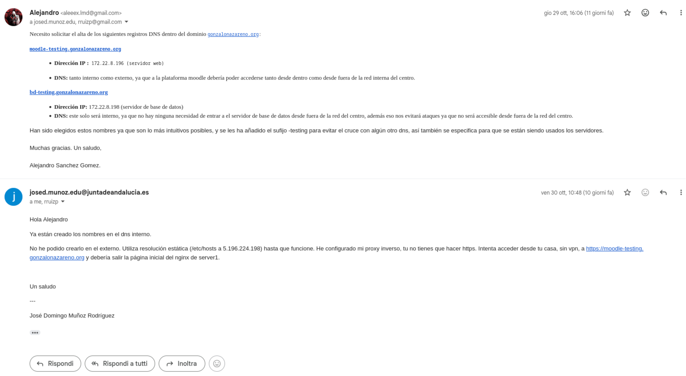


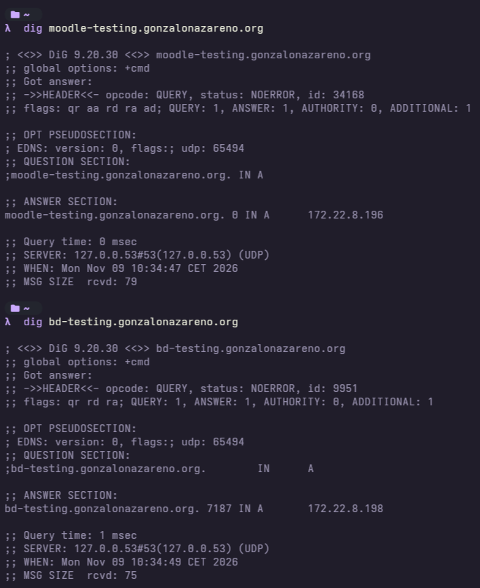

## PHP2Shell: versión de PHP instalada, resultado de tu comprobación del changelog / Debian Security Tracker y decisión tomada si no estaba corregida.

Me he decantado por la version 8.4.27-1~deb13u1 de php ya que corrije las dos vulnerabilidades de las versiones anteriores y es la version mas nueva de de php 8.4 por lo cual su instalacioon es bastante sencilla

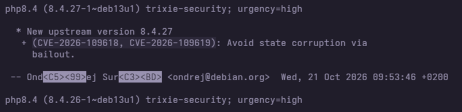

Como podemos ver estan ambas vulnerabilidades resueltas por lo que no tenemos que hacer nada mas.

## server2:
    - Configuración de pg_hba.conf y de postgresql.conf que has modificado (sólo las líneas relevantes).
   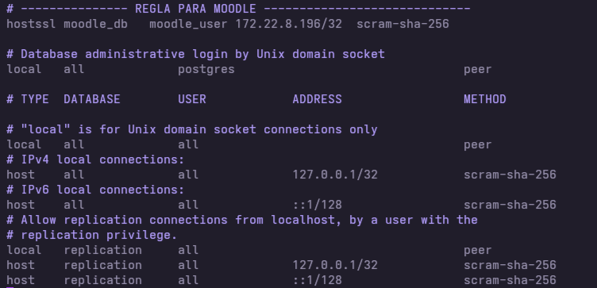
   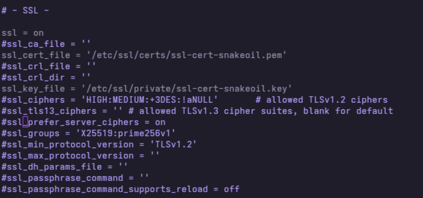

    - Salida de \conninfo y de pg_stat_ssl mostrando conexión cifrada, y capturas de rechazo sin TLS / desde otra IP.
   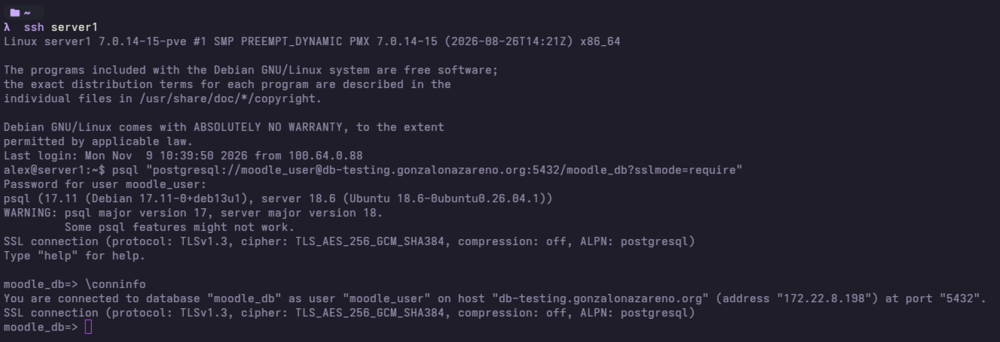
   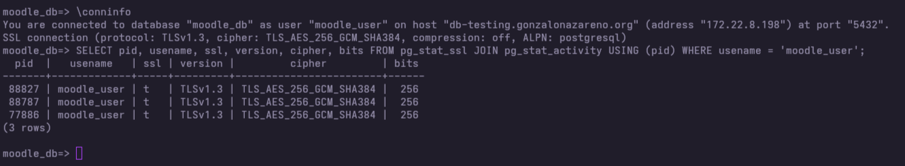
   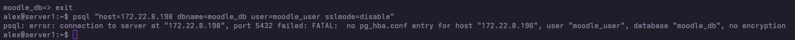
    
    - Fichero /etc/nftables.conf, salida de sudo nft list ruleset y resultado de las pruebas con nmap/nc.

   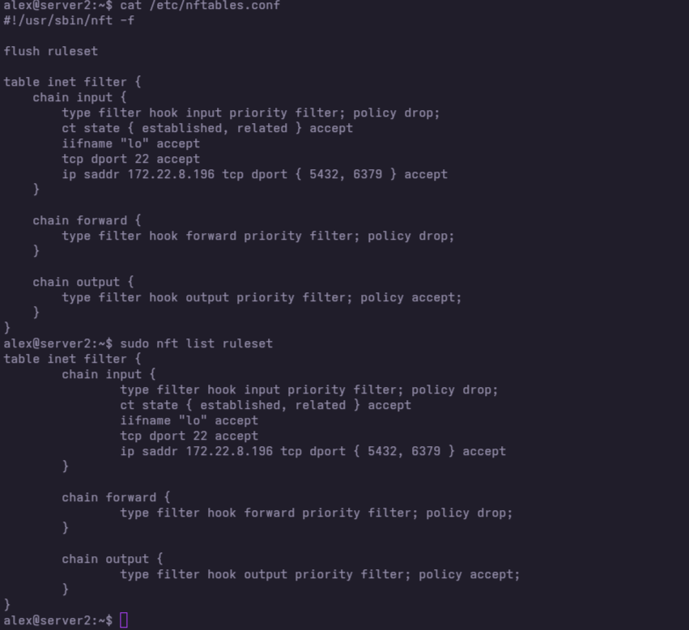

   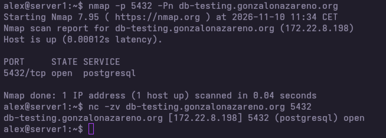
    
    - Configuración de Redis relevante (bind, autenticación).
   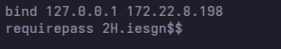

## server1:

    - Fichero de configuración del pool de PHP-FPM y de PHP que has creado.
   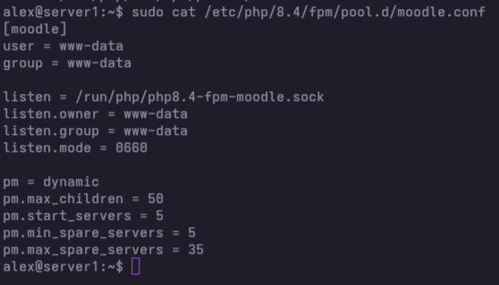

    - Server block de nginx, salida de nginx -t y comprobación del certificado (openssl s_client) y de las cabeceras (curl -I).

    ```conf
    alex@server1:~$ sudo cat /etc/nginx/sites-available/00-moodle.conf
server {
    if ($host = moodle-testing.gonzalonazareno.org) {
        return 301 https://$host$request_uri;
    } # managed by Certbot


    listen 80;
    server_name moodle-testing.gonzalonazareno.org 172.22.8.196;
    return 301 https://$host$request_uri;


}

server {
    listen 443 ssl default_server;
    http2 on;
    server_name moodle-testing.gonzalonazareno.org 172.22.8.196;

    root /var/www/moodle/public;
    index index.php index.html index.htm;

    ssl_protocols TLSv1.2 TLSv1.3;
    ssl_ciphers 'ECDHE-ECDSA-AES128-GCM-SHA256:ECDHE-RSA-AES128-GCM-SHA256:ECDHE-ECDSA-AES256-GCM-SHA384:ECDHE-RSA-AES256-GCM-SHA384:DHE-RSA-AES128-GCM-SHA256:DHE-RSA-AES256-GCM-SHA384';
    ssl_prefer_server_ciphers on;
    ssl_certificate /etc/letsencrypt/live/moodle-testing.gonzalonazareno.org-0001/fullchain.pem; # managed by Certbot
    ssl_certificate_key /etc/letsencrypt/live/moodle-testing.gonzalonazareno.org-0001/privkey.pem; # managed by Certbot
    
    ssl_session_cache shared:SSL:10m;
    ssl_session_timeout 1d;

    server_tokens off;

    add_header Strict-Transport-Security "max-age=63072000; includeSubDomains; preload" always;
    add_header X-Content-Type-Options "nosniff" always;
    add_header X-Frame-Options "SAMEORIGIN" always;
    add_header Referrer-Policy "strict-origin-when-cross-origin" always;

    access_log /var/log/nginx/moodle_access.log;
    error_log /var/log/nginx/moodle_error.log;

    client_max_body_size 100M;

    location ^~ /moodledata/ {
        return 404;
    }

    location ~* /moodledata/.*\.(php|php5|phtml)$ {
        deny all;
    }

    location ~ /\.(?!well-known).* {
        return 404;
    }

    location ~* /(?:behat|tests|fixtures|node_modules|vendor)/ {

    ```
   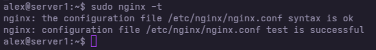

   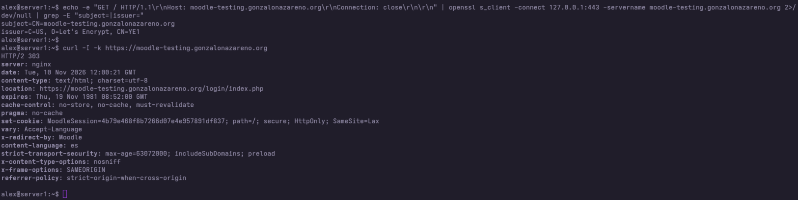

    - Estructura de directorios y permisos de Moodle, moodledata y config.php (ls -l, namei -l) (sin mostrar contraseñas).

   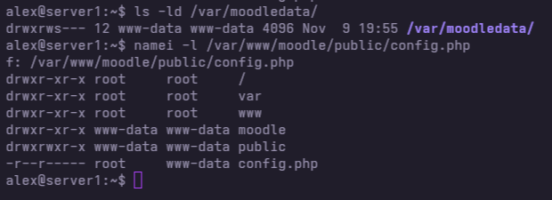

    - Comando de instalación CLI utilizado (sin contraseñas) y captura de Moodle funcionando por HTTPS.

    ```bash
    sudo -u www-data php /var/www/moodle/public/admin/cli/install.php \
    --chmod=2770 \
    --lang=es \
    --wwwroot=https://moodle-testing.gonzalonazareno.org \
    --dataroot=/var/moodledata \
    --dbtype=pgsql \
    --dbhost=localhost \
    --dbname=moodle \
    --dbuser=moodleuser \
    --dbpass="***" \
    --prefix=mdl_ \
    --fullname="Moodle Testing Platform" \
    --shortname="MoodleTest" \
    --adminuser=admin \
    --adminpass="***" \
    --adminemail=admin@gonzalonazareno.org \
    --agree-license
    ```

    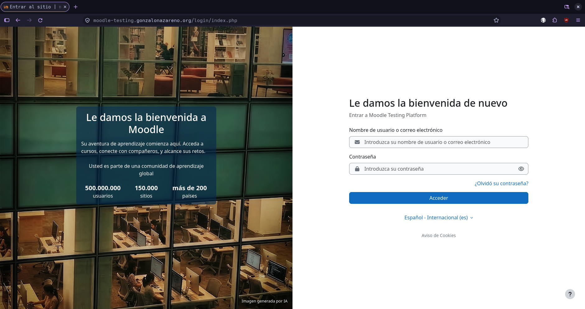


    - Ficheros .service y .timer del cron y salida de systemctl list-timers.

    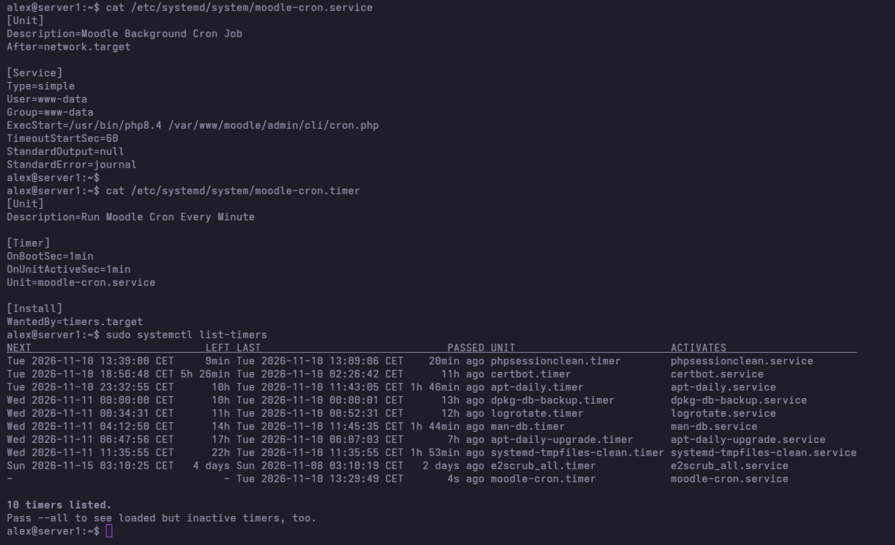
    
    - Configuración de sesiones/caché de Moodle en Redis y salida de redis-cli con claves de sesión.

    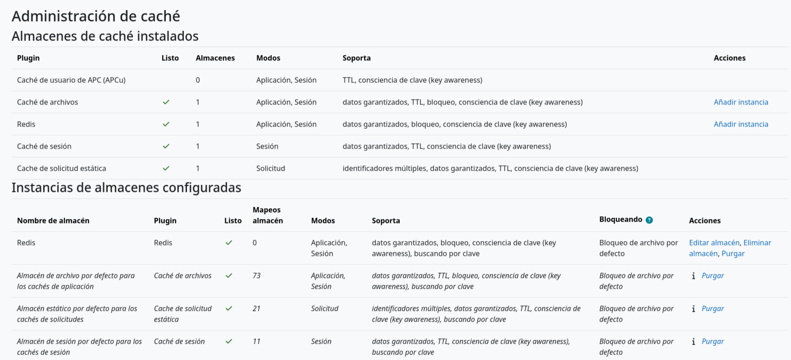
    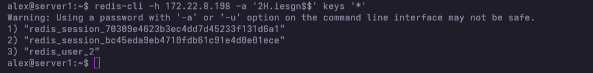
    
    - Filtro y jail de fail2ban para Moodle y prueba del baneo.

    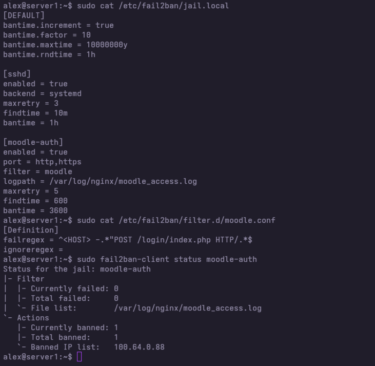
    
    - Prueba de que no se ejecuta PHP en directorios de subidas.

    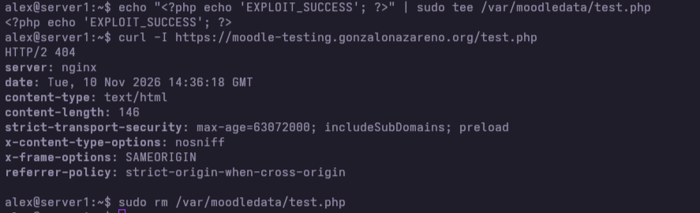
    
    
    - Fichero drop-in de systemd de PHP-FPM y salida de systemd-analyze security antes y después


## Respuesta a las preguntas planteadas:

    - ¿Por qué es importante que el código de Moodle no sea escribible por el usuario de PHP-FPM y que moodledata esté fuera de la raíz web?
    Es importante ya que si un usuario malicioo intentara atacar nuestra web directamente desde el usuuario web si pudiese escrir podria añadir codigo malicioso, al restringir la escritura al usuario web nos quitamos ese problema.
    Tambien es importante que los datos esten fuera del directorio raiz para que no sean accesibles por ngix y este no los meta en un enlace que pueda ser accesible por usuarios no deseados.


    - ¿Por qué un servidor de base de datos no debe tener registro en el DNS externo y cómo sirve el certificado comodín para cifrar la conexión con PostgreSQL?
    Al no tener dns externo nos evitamos problemas de ataques al servidor de base de datos ya que para poder accceder a este necesitamos estar en la misma red.
    El usar un cifrado hace que nadie que intercepte la comunicacion entre el cliente y el servidor pueda descifrarla sin las claves por lo cual lo vuelve mas seguro.


    - ¿Qué ventajas e inconvenientes tiene guardar las sesiones de Moodle en Redis?
    Las ventajas mas notables son un mayor rendimiento y la posibilidad de escalar a una arquitectura mas grande y los inconveniente son la volatilidad del srvicio al estar almacenado en ram, por lo tanto tambien un mayor consumo de memoria ram y que si redis cae moodle no podria acceder a las sesiones de los ususarios.

    - ¿En qué consiste la vulnerabilidad PHP2Shell y qué medidas has tomado (y cuáles no te habrían protegido)?
    La vulneravilidad consiste en unos fallos que tiene el servicio al prodiucise un desbordamiento de memoria los cuales permiten desde la ejecucion de codigo remoto hasta la filtracion de datos sensibles de la web.
    La medida que he probado y me ha funcionado ha sido buscar una version de php en la que esten parcheadas ambas vulneravilidades. Lo que no me sirvio fue midificicar a nivel de permisos ni aislar el moodle data ya que por decirlo de alguna forma el atacante se saltaria esas medidas.
    
    
    - ¿Qué diferencia hay entre verify-ca y verify-full en PostgreSQL?
    El verify-ca acepta la conexion si el certoficado esta firmado por una autoridad certificadora que sea de confianza mientras que el verify-full hace eso y ademas mira si el dominio coincide con el configurado en la misma conexion y si este no coincide la rechaza.